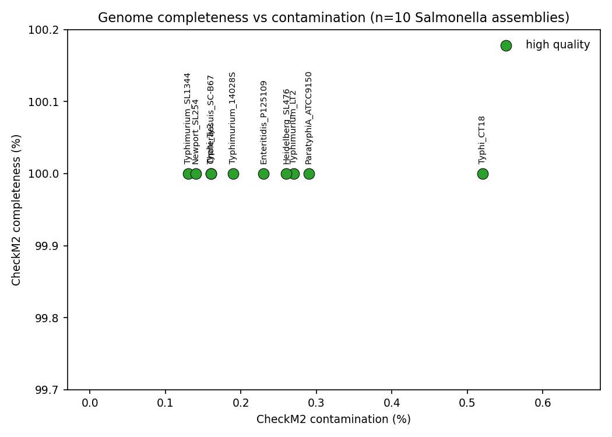
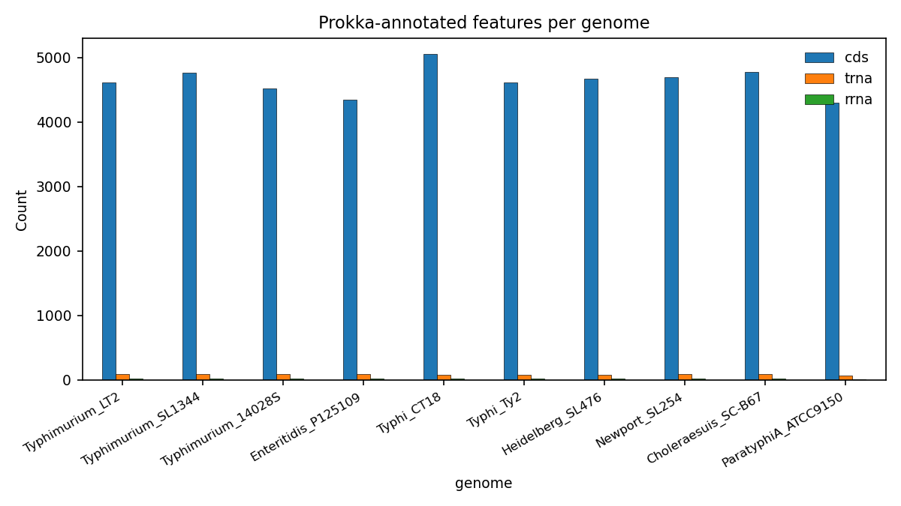
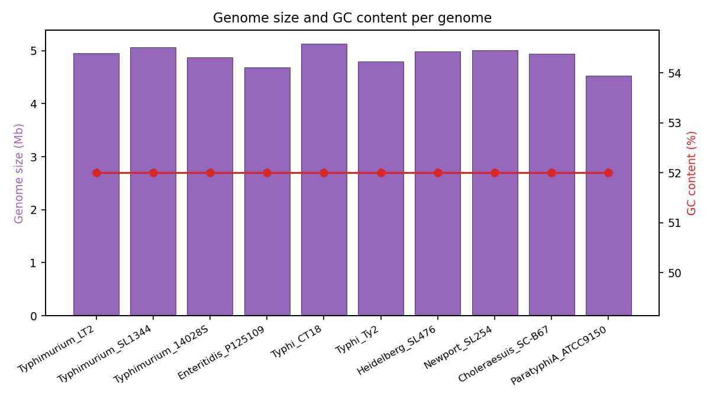

# Bacterial Genome QC + Annotation

Quality control and annotation of 10 *Salmonella enterica* genome assemblies: CheckM2 completeness/contamination assessment combined with Prokka structural annotation (CDS, tRNA, rRNA counts) in one summary table with QC verdicts and publication-ready figures.

This repo is the second half of a two-part portfolio story on the same 10 genomes. The companion repo ([salmonella-amr-gene-profiling](https://github.com/Hasnainsaeed01/salmonella-amr-gene-profiling)) profiled antimicrobial resistance genes in these assemblies; this repo checks their quality and annotates them.

## Dataset

10 *Salmonella enterica* assemblies from NCBI (same set as the AMR project):

| Label | Accession | Serovar | Strain |
|---|---|---|---|
| Typhimurium_LT2 | GCF_000006945.2 | Typhimurium | LT2 |
| Typhimurium_SL1344 | GCF_000210855.2 | Typhimurium | SL1344 |
| Typhimurium_14028S | GCF_008244845.1 | Typhimurium | 14028S |
| Enteritidis_P125109 | GCF_000009505.1 | Enteritidis | P125109 |
| Typhi_CT18 | GCF_000195995.1 | Typhi | CT18 |
| Typhi_Ty2 | GCF_000007545.1 | Typhi | Ty2 |
| Heidelberg_SL476 | GCF_000020705.1 | Heidelberg | SL476 |
| Newport_SL254 | GCF_000016045.1 | Newport | SL254 |
| Choleraesuis_SC-B67 | GCF_000008105.1 | Choleraesuis | SC-B67 |
| ParatyphiA_ATCC9150 | GCA_010634545.1 | Paratyphi A | ATCC 9150 |

Nine are complete genomes (1-4 contigs); Paratyphi A ATCC 9150 is a draft assembly (55 contigs). Full metadata in `data/genome_metadata.csv`. Assemblies are downloaded with `data/download_assemblies.sh` (NCBI Datasets CLI) and are not bundled in the repo.

## Methods

1. **Quality control with CheckM2 v1.0.1** (`checkm2 predict`, 8 threads). The CheckM2 run was performed on a separate workstation; the resulting `results/checkm2_quality_report.tsv` is bundled here and is the QC source for this analysis.
2. **Annotation with Prokka 1.15.6** (default settings, `--kingdom Bacteria`), one run per assembly. Per-genome feature counts (CDS, tRNA, rRNA, tmRNA) were parsed from the Prokka `.txt` stats files (bundled in `results/prokka_stats/`); the full Prokka output directories are not bundled.
3. **Summary** with `qc_analysis.py` (Python 3, pandas, matplotlib): joins the CheckM2 report with the Prokka stats into `results/genome_qc_summary.csv` and renders the figures.

**QC verdict rule:** completeness >= 90% AND contamination <= 5% is "high quality", otherwise "check". This follows the widely used high-quality draft genome standard.

## Results summary

| Metric | Value |
|---|---|
| Genomes analyzed | 10 |
| Mean CheckM2 completeness | 100.0% |
| Mean CheckM2 contamination | 0.24% |
| Genomes passing QC (high quality) | 10 / 10 |
| Total CDS annotated (Prokka) | 46,388 |
| Most CDS in one genome | Typhi_CT18 (5,052) |
| Fewest CDS in one genome | ParatyphiA_ATCC9150 (4,303) |
| Genome size range | 4.53 - 5.13 Mb |
| GC content | 52% (all genomes) |

All 10 assemblies are essentially complete (100.0% CheckM2 completeness) with negligible contamination (0.13-0.52%), so every genome passes the high-quality threshold. Prokka annotation is consistent with a ~4.5-5.1 Mb *Salmonella* genome: roughly 4,300-5,050 CDS, 69-88 tRNAs, and 22 rRNAs per complete genome. The draft Paratyphi A assembly (55 contigs) predictably annotates fewer features (4 rRNAs vs 22 in the complete genomes), which is expected for a fragmented assembly, not a QC failure.

### Completeness vs contamination



### Annotated features per genome



### Genome size and GC content per genome



## Requirements

- Python 3.8+ with `pandas` and `matplotlib` (analysis and figures only)
- NCBI Datasets CLI (`datasets`) to fetch assemblies
- CheckM2 v1.0.1+ and Prokka 1.15.6+ to reproduce the full pipeline (both free, installable via conda/bioconda)

## How to run

```bash
# 1. Download the 10 assemblies (~50 MB total)
bash data/download_assemblies.sh

# 2. Run CheckM2 QC (or reuse the bundled results/checkm2_quality_report.tsv)
bash run_qc_annotation.sh

# 3. Build the summary table and figures
python3 qc_analysis.py
```

`run_qc_annotation.sh` documents the exact CheckM2 and Prokka commands used. `qc_analysis.py` is fully commented and reads only the bundled files in `results/`, so step 3 works standalone without rerunning the tools.

## Repository layout

```
bacterial-genome-qc-annotation/
├── README.md
├── .gitignore
├── run_qc_annotation.sh        # reproducible CheckM2 + Prokka pipeline
├── qc_analysis.py              # summary table + figures (commented)
├── data/
│   ├── download_assemblies.sh  # fetches the 10 assemblies from NCBI
│   └── genome_metadata.csv     # accession list and assembly metadata
├── results/
│   ├── checkm2_quality_report.tsv   # CheckM2 predict output (bundled)
│   ├── prokka_stats/                # per-genome Prokka .txt stats (bundled)
│   └── genome_qc_summary.csv        # combined table with QC verdicts
└── figures/
    ├── 01_completeness_contamination.png
    ├── 02_features_per_genome.png
    └── 03_size_gc_per_genome.png
```
